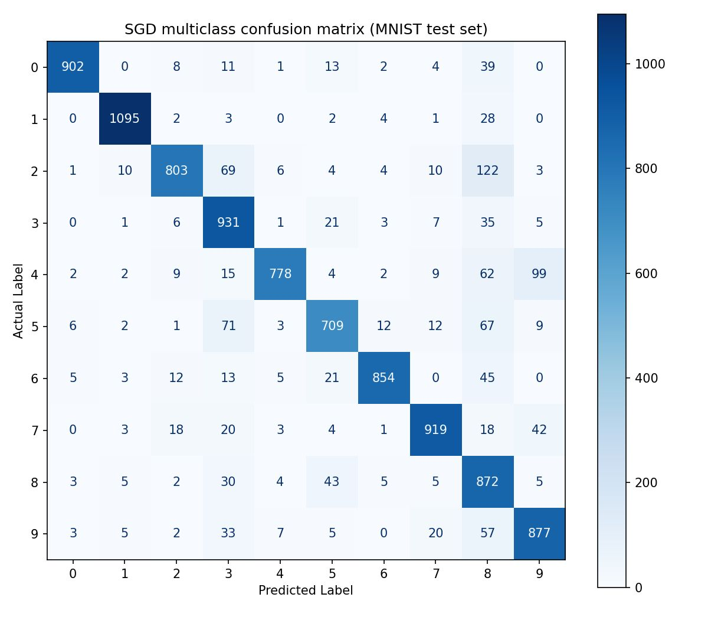

# MNIST Digit Classification: SGD vs Random Forest

Classic scikit-learn project on MNIST (60,000 training images, 10,000 test images, 28x28 pixels flattened to 784 features).

## What it does
1. **Binary "5 detector"** with `SGDClassifier`, evaluated with 3-fold cross-validation.
2. **Comparison** with a `RandomForestClassifier` on the same task.
3. **Multiclass classifier** (all 10 digits) with `SGDClassifier`, evaluated on the test set.
4. **Effect of feature scaling** (`StandardScaler`) on multiclass accuracy.
5. **Error analysis** with a confusion matrix.

## Results (all numbers from one run of `mnist_classification.py`, random_state=42)

### 5 vs not-5 (3-fold CV on the training set)
| Model | Precision | Recall | F1 |
|---|---|---|---|
| SGD | 0.837 | 0.651 | 0.733 |
| Random Forest | 0.991 | 0.866 | 0.924 |

SGD confusion matrix (rows = actual, columns = predicted): `[[53892, 687], [1891, 3530]]`.
Random Forest is clearly better here: higher precision and higher recall. A linear model on raw pixels is limited, while trees handle the pixel patterns better.

### All 10 digits (SGD, test set)
| Features | Accuracy |
|---|---|
| Raw pixels (0-255) | 0.874 |
| Standardized | 0.893 |

Scaling gave about +1.9 percentage points.

### Which digits get confused (raw-pixel model, actual -> predicted)
- 2 -> 8: 122 images
- 4 -> 9: 99 images
- 5 -> 3: 71 images (3 -> 5 is only 21)
- 2 -> 3: 69 images
- 5 -> 8: 67 images

Lowest per-digit recall: digit 2 (0.778), 4 (0.792), 5 (0.795). Highest: digit 1 (0.965).
Digits with similar shapes (2/8, 4/9, 3/5) get mixed up.



## Run it
```
pip install scikit-learn matplotlib numpy
python mnist_classification.py
```
Uses `tensorflow.keras.datasets.mnist` if TensorFlow is installed, otherwise loads the same standard split from OpenML. Runtime is a few minutes on a single CPU.

## Ideas to improve
- Try `RandomForest` or an SVM on the full 10-digit task.
- Tune hyperparameters with `GridSearchCV`.
- Try a small neural network or a CNN.
